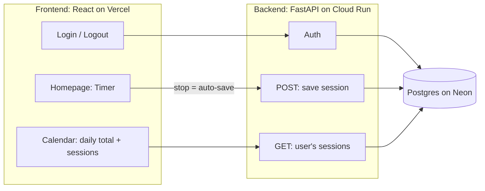
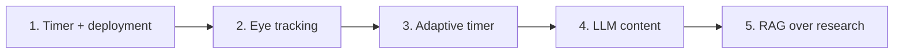

# Focus Me

A learning app with an adaptive focus timer. It uses eye tracking to find your best focus and break intervals, and an LLM to build engaging learning paths. Prototype: learning Persian.

## Architecture (Phase 1)

## Roadmap

## Tech Stack

React · FastAPI · PostgreSQL · Docker · Vercel · Google Cloud Run · Neon
