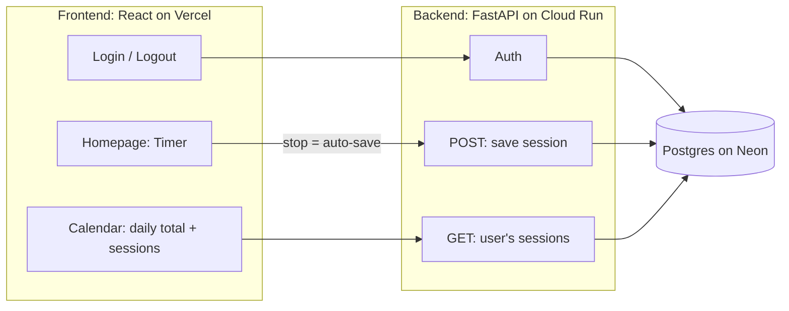
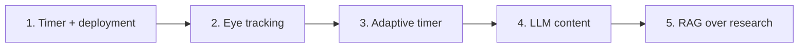

# Focus Me

A learning app with an adaptive focus timer. It uses eye tracking to find your best focus and break intervals, and an LLM to build engaging learning paths. Prototype: learning Persian.

## Architecture (Phase 1)



## Roadmap



## Tech Stack

React · FastAPI · PostgreSQL · Docker · Vercel · Google Cloud Run · Neon

## Running the backend

Requires Python 3.10+.

First-time setup:

```bash
cd backend
python3 -m venv .venv
source .venv/bin/activate
pip install -r requirements.txt
```

Start the dev server:

```bash
cd backend
source .venv/bin/activate
uvicorn app.main:app --reload
```

The API runs at http://127.0.0.1:8000. Check it with http://127.0.0.1:8000/health, and see the interactive API docs at http://127.0.0.1:8000/docs.
